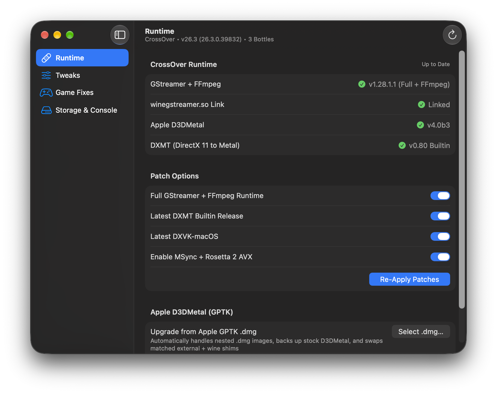

<p align="center">
  
</p>

<h1 align="center">HexAid</h1>

<p align="center">
  An in-place patcher for CrossOver on Apple Silicon. Upgrades GStreamer (with FFmpeg), DXMT, DXVK, and bottle tweaks without duplicating <code>CrossOver.app</code>.
</p>

<p align="center">
  <a href="https://github.com/passs0/HexAid/releases/latest"></a>
  
  <a href="LICENSE"></a>
</p>

<p align="center">
  
</p>

---

## What it does

- **In-place patching:** Detects CrossOver and CrossOver Preview and patches the selected bundle directly so existing bottles pick up the updates.
- **GStreamer + FFmpeg:** Installs [`Sikarugir-App/gstreamer`](https://github.com/Sikarugir-App/gstreamer) and links `winegstreamer.so` to fix broken or frozen UE4/UE5 cutscenes.
- **DXMT & DXVK:** Pulls the latest [`3Shain/dxmt`](https://github.com/3Shain/dxmt) and optional [`Gcenx/DXVK-macOS`](https://github.com/Gcenx/DXVK-macOS) releases while leaving CrossOver's `D3DMetal.framework` intact.
- **Optimizations:** Toggles NVIDIA RTX (`0x10DE`) D3DMetal spoofing, Metal Performance HUD (`MTL_HUD_ENABLED=1`), macOS Game Mode, `WINEMSYNC=1`, and `ROSETTA_ADVERTISE_AVX=1`.
- **Game Fixes add-ons:** Downloads and runs game-specific fixes like [`RE9-CrossOver-Fix`](https://github.com/passs0/RE9-CrossOver-Fix) and [`SH2R-CrossOver-Fix`](https://github.com/passs0/SH2R-CrossOver-Fix) on demand.
- **Cache cleanup:** Inspects and clears D3DMetal shader caches and GStreamer registries.

## Install

Download **`HexAid-v2.4.0.dmg`** from [Releases](https://github.com/passs0/HexAid/releases/latest) and drag `HexAid.app` to `/Applications`.

If Gatekeeper blocks the first launch:
```zsh
xattr -cr /Applications/HexAid.app
```

Or build from source:
```zsh
git clone https://github.com/passs0/HexAid.git && cd HexAid
./build.sh
cp -R build/HexAid.app /Applications/
```

## Credits

Inspired by [CXPatcher](https://github.com/italomandara/CXPatcher) and [Procyon](https://github.com/italomandara/Procyon) by [@italomandara](https://github.com/italomandara), [3Shain/dxmt](https://github.com/3Shain/dxmt), [Sikarugir-App/gstreamer](https://github.com/Sikarugir-App/gstreamer), and [Gcenx/DXVK-macOS](https://github.com/Gcenx/DXVK-macOS).

## AI Scope

All code, UI/assets, and documentation in this project were generated with [Google Antigravity](https://antigravity.google). Human involvement was limited to direction, design feedback, and hands-on testing.

## License

[MIT](LICENSE)
